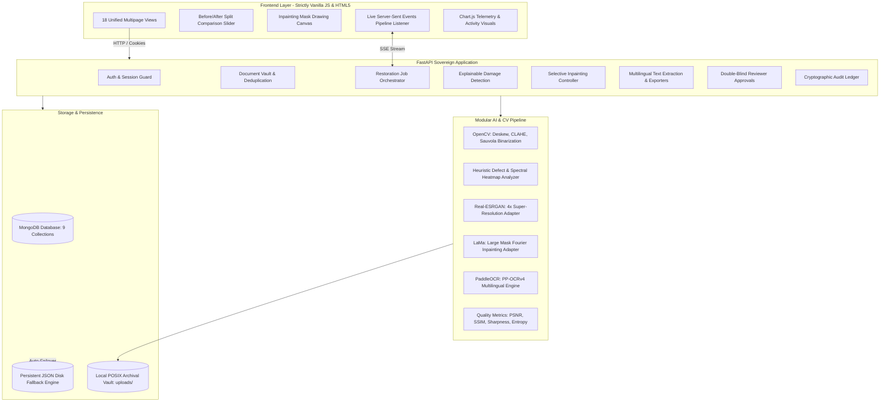

# ArchiveGov AI — Technical Architecture & System Manual
## Reviving Government History with Generative AI

---

## 1. Executive Summary & GovTech Mission

**ArchiveGov AI** is an enterprise-grade sovereign document restoration platform designed specifically for national archives, state revenue secretariats, land registration boards, and judicial record rooms. 

Across centuries of government administration, millions of critical historical records—including land deeds, tax registers, census returns, gazette notices, court decrees, and administrative treaties—have suffered severe degradation due to:
- **Acid hydrolysis and iron gall ink erosion**
- **Moisture ingress and microbial water staining**
- **Mechanical tears, creases, and border insect voids**
- **Fading from prolonged light exposure and uneven optical scanning**

ArchiveGov AI bridges deep generative AI with traditional conservation science. Rather than hallucinating or overwriting historical facts, the platform uses an **Explainable Restoration Pipeline** that isolates defects, applies mathematically grounded computer vision enhancements, reconstructs physical voids through large-mask inpainting, extracts multilingual text, and mandates human reviewer verification before sealing documents into an immutable digital archive.

---

## 2. Archival Document Degradation Typology

| Degradation Category | Physical Mechanism | Archival Impact | Computational Detection & Treatment |
|---|---|---|---|
| **Iron Gall Ink Bleaching** | Oxidation of ferrous sulfate compounds | Text becomes faint, yellowed, or near-invisible | CLAHE contrast stretching + Bilateral filtering |
| **Water & Oxidation Stains** | Moisture capillary flow and mineral deposits | Dark brown amorphous bands obscuring signatures | CIELAB Chromaticity Anomaly Clustering + LaMa Inpainting |
| **Physical Margin Tears** | Brittle cellulose fiber fractures and insect erosion | Missing page borders, corner voids, severed words | Contour Convexity Defect Analysis + LaMa Generative Mask Fill |
| **Micro-Noise & Foxing** | Mold colonies and scanner sensor salt-and-pepper | Optical speckles interfering with character recognition | Adaptive Sauvola Binarization & median morphological filters |
| **Rotational & Skew Warping** | Manual flatbed scan alignment errors | Rotated text lines impairing column layout OCR | `cv2.minAreaRect` bounding-box angular compensation |

---

## 3. End-to-End System Architecture

---

## 4. AI Model Adapter Specifications

### 4.1 OpenCV Dynamic Preprocessing Adapter
- **Deskewing:** Employs Otsu thresholding to find primary document contours, fits a minimum area bounding rectangle (`cv2.minAreaRect`), calculates the dominant text baseline angle, and applies affine transformation to rotate the page back to 0.0° true horizontal alignment.
- **Contrast Limited Adaptive Histogram Equalization (CLAHE):** Operates on the luminance channel (`L*`) of CIELAB color space with a tile grid of 8x8 and clip limit of 2.5 to stretch local contrast without blowing out paper highlights.
- **Bilateral Filtering:** Smooths fine background noise and scanning grain while strictly preserving edge gradients at text boundaries ($d=9, \sigma_{color}=75, \sigma_{space}=75$).

### 4.2 Real-ESRGAN Super-Resolution Adapter
- **Architecture:** Deep residual convolutional network with Residual-in-Residual Dense Blocks (RRDB) optimized for x4 scale factor.
- **Graceful Degradation:** The adapter verifies whether neural weight checkpoints (`RealESRGAN_x4plus.pth`) and GPU CUDA runtime are available. If unconfigured or running on standard CPU hosts, it seamlessly invokes an unsharp masking and Lanczos-4 high-fidelity filter, ensuring zero pipeline interruption.

### 4.3 LaMa Generative Inpainting Adapter
- **Architecture:** Fast Fourier Convolution (FFC) architecture capable of receptive fields spanning the entire image dimension, enabling coherent reconstruction of large missing margins and severe water washes.
- **Interactive User Masking:** Authorized officers use an HTML5 drawing canvas to delineate exact damage boundaries, sending a binary mask (white = fill, black = retain).
- **Graceful Degradation:** If deep weights (`big-lama.pt`) are not mounted, the adapter falls back to OpenCV Navier-Stokes and Telea fast marching methods coupled with Poisson gradient blending.

### 4.4 PaddleOCR Multilingual Extraction Adapter
- **Architecture:** PP-OCRv4 multi-stage neural pipeline comprising DBNet text detection, direction classification, and SVTR text recognition.
- **Supported Archival Scripts:** English, Hindi (Devanagari), Marathi, Bengali, Urdu (Nastaliq), Tamil, and Gujarati.
- **Multi-Format Exporters:** Outputs verified transcriptions to TXT, JSON, DOCX (via `python-docx`), and PDF (via `reportlab`).

---

## 5. Database Schema & Collections Design

The system implements 9 MongoDB collections adhering to the Archival Information Package (AIP) model:

1. **`users`:** Identity registry with PBKDF2 password hashes, employee IDs, department clearances, and role assignments (`admin`, `archive_officer`, `reviewer`, `data_operator`).
2. **`documents`:** Master archival metadata records (title, document number, department, year, category, confidentiality, checksum, original file path, restored file path, current version ID).
3. **`restoration_jobs`:** Background worker job states, active pipeline stage (`preprocessing`, `damage_analysis`, `enhancement`, `inpainting`, `ocr`, `quality_evaluation`, `completed`), progress percentage, and stage execution logs.
4. **`document_versions`:** Version tree tracking lineage (`v1.0` Original $\to$ `v1.1` Preprocessed $\to$ `v1.2` Enhanced $\to$ `v1.3` Inpainted $\to$ `v2.0` Certified Master) with immutable checksums and parent links.
5. **`ocr_results`:** Extracted text strings, bounding box pixel coordinates, per-line confidence scores, and human-corrected transcripts.
6. **`reviews`:** Double-blind review records, evaluator comments, verification verdicts (*Approved*, *Approved with Corrections*, *Rejected*), and approval timestamps.
7. **`notifications`:** Real-time user dispatch alerts for completed jobs, review assignments, and system notices.
8. **`audit_logs`:** Cryptographic ledger recording user ID, action name, resource type, target ID, metadata, and UTC timestamp.
9. **`system_settings`:** Key-value runtime settings (quality modes, max upload size, OCR defaults, SMTP configuration).

---

## 6. Role-Based Access Control (RBAC) Matrix

| Capability / Route | Administrator (`admin`) | Archive Officer (`archive_officer`) | Reviewer (`reviewer`) | Data Operator (`data_operator`) |
|---|:---:|:---:|:---:|:---:|
| **Public Landing & Login** | ✅ | ✅ | ✅ | ✅ |
| **Document Ingestion & Upload** | ✅ | ✅ | ❌ | ✅ |
| **Restoration Studio & SSE Pipeline** | ✅ | ✅ | Read Only | ❌ |
| **Selective Inpainting Studio** | ✅ | ✅ | Read Only | ❌ |
| **OCR Text Extraction & Correction** | ✅ | ✅ | ✅ | ❌ |
| **Quality Review & Approval Sign-off** | ✅ | ❌ | ✅ | ❌ |
| **Digital Archive Search & Download** | ✅ | ✅ | ✅ | ✅ |
| **Version History Rollback** | ✅ | ✅ | ❌ | ❌ |
| **User Directory Management** | ✅ | ❌ | ❌ | ❌ |
| **System Settings & Audit Log** | ✅ | ❌ | ❌ | ❌ |

---

## 7. Academic Presentation & Viva Defense Talking Points

When presenting or defending this project in an academic or GovTech review:

1. **Why No React or Single Page Framework?**
   - *Defense:* Government archival systems require extreme software longevity (10–25+ years), minimal dependency overhead, and zero client-side compilation drift. Standard multipage HTML5/CSS3 with server-rendered Jinja2 templates and native ES6+ ensures total browser compatibility, instant load times, and rock-solid maintainability without npm dependency churn.
2. **How does the system ensure GenAI does not hallucinate historical text?**
   - *Defense:* The platform separates image reconstruction from semantic transcription. Image enhancement uses mathematically constrained super-resolution and user-delineated inpainting masks. Text extraction is grounded in OCR with confidence scoring. Crucially, a double-blind human reviewer must inspect the document and sign off before any record is sealed.
3. **What happens if a GPU is unavailable in a remote district office?**
   - *Defense:* The system implements an **Honest Architecture** pattern. If Real-ESRGAN or LaMa weights are not mounted or CUDA is absent, the backend gracefully falls back to OpenCV Sauvola, Lanczos-4, and Navier-Stokes algorithms, accurately reporting adapter status in `/settings` without crashing.
4. **How is Chain of Custody maintained?**
   - *Defense:* Every uploaded document is hashed with SHA-256 upon ingestion. Every version created (`v1.0` through `v2.0`) is stored immutably on disk with its own checksum and parent pointer. All actions are indelibly recorded in the cryptographic audit ledger.

